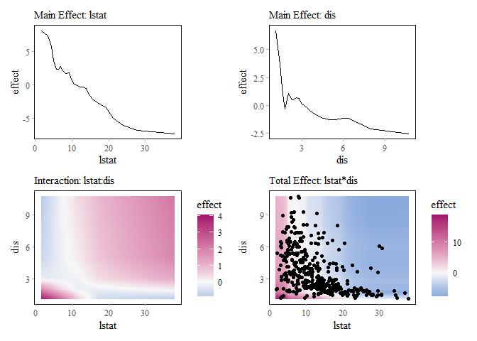
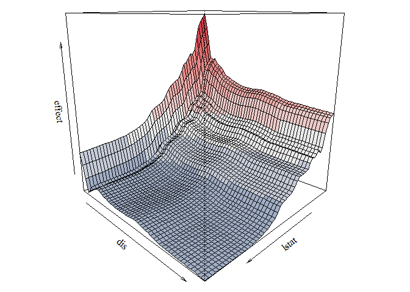
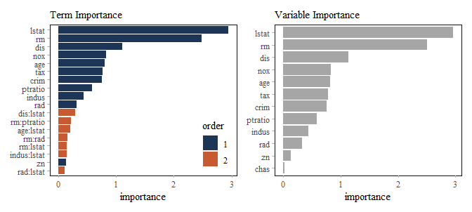
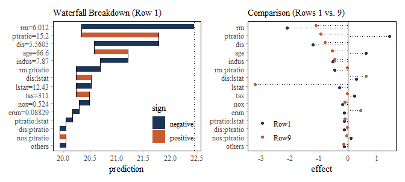
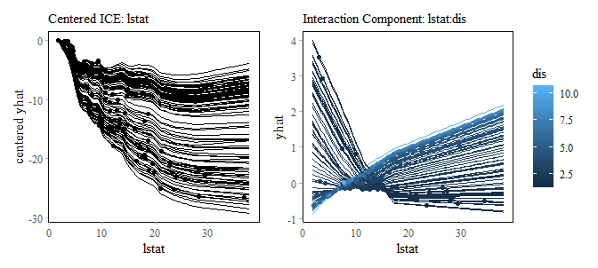
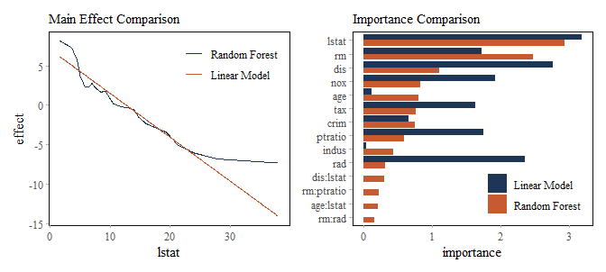
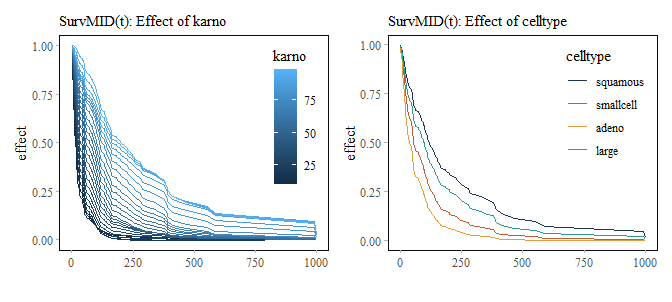

# midr

The goal of **midr** is to provide a model-agnostic framework for
interpreting black-box predictive models by constructing a globally
interpretable surrogate model via **Maximum Interpretation Decomposition
(MID)**. MID finds an optimal functional ANOVA decomposition (main
effects and low-order interactions) that minimizes the squared error
against the target model’s predictions. The theoretical foundations are
described in Iwasawa & Matsumori (2026) \[Forthcoming\], and the package
itself is detailed in [Asashiba et
al. (2025)](https://arxiv.org/abs/2506.08338).

## Installation

You can install the released version of **midr** from
[CRAN](https://cran.r-project.org/) with:

``` r

install.packages("midr")
```

and the development version from [GitHub](https://github.com/) with:

``` r

# install.packages("pak")
pak::pak("ryo-asashi/midr")
```

## Surrogate Modeling and Component Plots

In this example, we fit a random forest to the `Boston` housing dataset
(`ISLR2`) and construct a two-dimensional MID surrogate with
[`interpret()`](https://ryo-asashi.github.io/midr/reference/interpret.md).

``` r

library(midr)
library(ggplot2)
library(patchwork)
library(ranger)
theme_set(theme_monograph())
midr_options(qualitative = "ukiyoe")
data("Boston", package = "ISLR2")
set.seed(42)
idx <- sample(nrow(Boston), nrow(Boston) * 0.75)
train <- Boston[ idx, ]
valid <- Boston[-idx, ]

rf <- ranger(medv ~ ., train, mtry = 5)
preds_rf <- predict(rf, valid)$predictions

mid <- interpret(medv ~ .^2, train, rf, lambda = 0.1)
mid
#> 
#> Call:
#> interpret(formula = medv ~ .^2, data = train, model = rf, lambda = 0.1)
#> 
#> Model Class: ranger
#> 
#> Intercept: 22.446
#> 
#> Main Effects:
#> 12 main effect terms
#> 
#> Interactions:
#> 66 interaction terms
#> 
#> Uninterpreted Variation Ratio: 0.016248

preds_mid <- predict(mid, valid)
c(
  rf_rmse = sqrt(mean((valid$medv - preds_rf)^2)),
  surrogate_rmse = sqrt(mean((preds_rf - preds_mid)^2))
)
#>        rf_rmse surrogate_rmse 
#>       3.351362       1.106667
```

Component functions can be visualized using either base graphics
([`plot()`](https://rdrr.io/r/graphics/plot.default.html)) or `ggplot2`
([`ggmid()`](https://ryo-asashi.github.io/midr/reference/plot.mid.md)).
Setting `main.effects = TRUE` (or `terms = "lstat * dis"`) displays the
total of main and interaction effects.

``` r

wrap_plots(
  ggmid(mid, "lstat") + labs(subtitle = "Main Effect: lstat"),
  ggmid(mid, "dis") + labs(subtitle = "Main Effect: dis"),
  ggmid(mid, "lstat:dis") + labs(subtitle = "Interaction: lstat:dis"),
  ggmid(mid, "lstat*dis", type = "compound") +
    labs(subtitle = "Total Effect: lstat*dis")
)
```



Perspective plots ([`persp()`](https://rdrr.io/r/graphics/persp.html))
are supported in **midr** starting from version 0.7.0.

``` r

par_monograph(mar = rep(0, 4))
persp(mid, "lstat*dis", theta =135, theme = "steps")
```



## Post-Hoc Explanations

**midr** provides unified `eval_*()` functions for global importance,
local prediction breakdowns, and individual conditional expectations
(ICE; Goldstein et al., 2015).

### Term and Variable Importance

[`eval_importance()`](https://ryo-asashi.github.io/midr/reference/eval_importance.md)
summarizes the contribution of each main and interaction term, or
aggregates them by variable with `by = "variable"`.

``` r

imp <- eval_importance(mid)
imp_var <- eval_importance(mid, by = "variable")

wrap_plots(
  nrow = 1L,
  ggmid(imp, max.nterms = 18, theme = "ukiyoe", legend = "bottomright") +
    labs(subtitle = "Term Importance"),
  ggmid(imp_var) +
    theme(legend.position = "none") +
    labs(subtitle = "Variable Importance")
)
```



### Prediction Breakdowns

[`eval_breakdown()`](https://ryo-asashi.github.io/midr/reference/eval_breakdown.md)
decomposes individual predictions into additive term effects. Passing
multiple indices to `rows` returns a `midbrks` collection for
side-by-side comparison.

``` r

bds <- eval_breakdown(mid, data = valid, rows = c(1L, 9L))
labels(bds) <- c("Row1", "Row9")
wrap_plots(
  nrow = 1L,
  ggmid(bds[[1L]], legend = "bottomright") +
    labs(subtitle = "Waterfall Breakdown (Row 1)"),
  ggmid(bds, type = "dotchart", legend = "bottomleft") +
    labs(subtitle = "Comparison (Rows 1 vs. 9)")
)
```



### Conditional Expectations (ICE)

[`eval_conditional()`](https://ryo-asashi.github.io/midr/reference/eval_conditional.md)
computes ICE curves for the full model or for any submodel extracted
with [`subset()`](https://rdrr.io/r/base/subset.html).

``` r

ice_full <- eval_conditional(mid, "lstat", max.nsamples = 100L)
ice_int  <- eval_conditional(subset(mid, terms = "lstat:dis"), "lstat", max.nsamples = 100L)

wrap_plots(
  nrow = 1L,
  ggmid(ice_full, type = "centered") +
    labs(subtitle = "Centered ICE: lstat"),
  ggmid(ice_int, var.color = dis) +
    labs(subtitle = "Interaction Component: lstat:dis")
)
```



## Multi-Model Comparison and SurvMID(t)

Multiple MID models can be bundled with
[`midlist()`](https://ryo-asashi.github.io/midr/reference/midlist.md)
(producing a `mids` / `midrib` collection) to compare surrogates across
different black-box models or hyperparameters.

``` r

lm_fit <- lm(medv ~ ., train)
mid_lm <- interpret(medv ~ ., train, lm_fit, k = 2)
mids <- midlist(
  "Random Forest" = mid,
  "Linear Model" = mid_lm
)

wrap_plots(
  nrow = 1L,
  ggmid(mids, "lstat", legend = "topright") +
    labs(subtitle = "Main Effect Comparison"),
  ggmid(
    eval_importance(mids),
    max.nterms = 14,
    legend = "bottomright"
  ) +
    labs(subtitle = "Importance Comparison")
)
```



When
[`interpret()`](https://ryo-asashi.github.io/midr/reference/interpret.md)
is given a prediction function that returns an $`n \times K`$
matrix—such as survival probabilities evaluated at multiple time
horizons $`t_1, \dots, t_K`$—it automatically fits a time-dependent
collection (**SurvMID(t)**) in a single call.

``` r

library(survival)
data("veteran", package = "survival")

cox_fit <- coxph(Surv(time, status) ~ karno + age + celltype, data = veteran)

smid <- interpret(
  Surv(time, status) ~ karno + age + celltype,
  data = veteran,
  model = cox_fit,
  lambda = 0.1
)

wrap_plots(
  nrow = 1L,
  ggmid(smid, "karno + 1", type = "series", legend = "topright") +
    labs(subtitle = "SurvMID(t): Effect of karno"),
  ggmid(smid, "celltype + 1", type = "series", legend = "topright") +
    labs(subtitle = "SurvMID(t): Effect of celltype")
)
```



## References

\[1\] Iwasawa, H. & Matsumori, Y. (2026). “A Functional Decomposition
Approach to Maximize the Interpretability of Black-Box Models”.
\[Forthcoming\]

\[2\] Asashiba, R., Kozuma, R. & Iwasawa, H. (2025). “midr: Learning
from Black-Box Models by Maximum Interpretation Decomposition”.
<https://arxiv.org/abs/2506.08338>

\[3\] Goldstein, A., Kapelner, A., Bleich, J., & Pitkin, E. (2015).
“Peeking Inside the Black Box: Visualizing Statistical Learning With
Plots of Individual Conditional Expectation”. *Journal of Computational
and Graphical Statistics*, *24*(1), 44–65.
<https://doi.org/10.1080/10618600.2014.907095>
